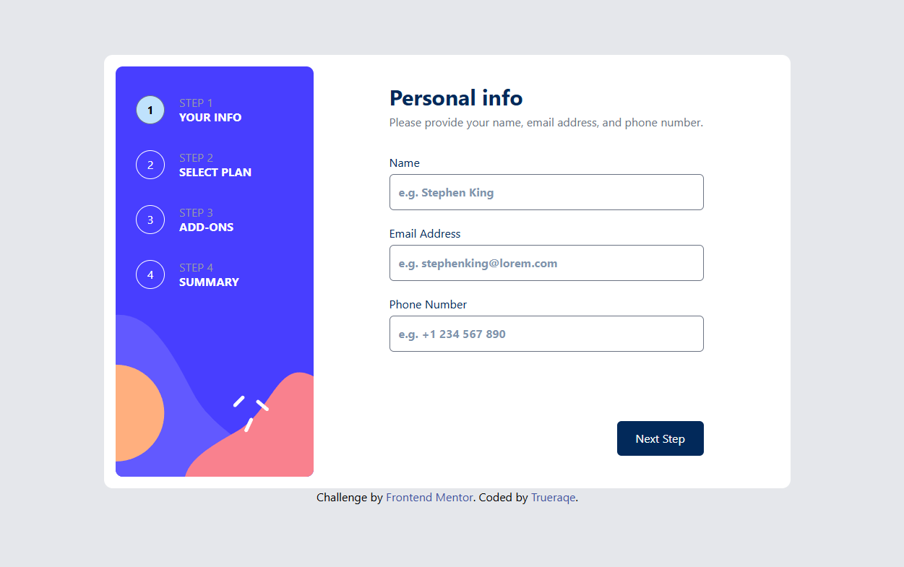

# Multi-step Form

A multi-step sign-up form built as a Frontend Mentor challenge. Users move through four steps: personal info, plan selection, add-ons and a final summary with a confirmation screen.



**Live demo:** [add your link here]

## Features
- Four-step flow with Next / Go Back navigation
- Form validation with error messages (required fields, email format)
- Plan selection with a monthly / yearly billing toggle
- Optional add-ons with prices that update with the billing period
- Summary with the total price and an option to change the plan
- Confirmation screen after submitting
- Responsive layout (mobile and desktop)
- Keyboard-friendly navigation

## Built with
- React
- TypeScript
- Tailwind CSS
- React Router
- Vite

## Getting started

```bash
git clone https://github.com/Trueraqe/[repo-name].git
cd [repo-name]
npm install
npm run dev
```

## What I learned
- Store the form data shared between steps
- Improve Tailwind CSS skills

## Author
[Trueraqe](https://github.com/Trueraqe)